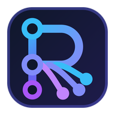

<p align="center">
  
</p>

# server

REST API and Model Context Protocol (MCP) server for **Resumeee** (`github.com/resumeee-app/server`).

## What It Contains

- **REST API & MCP HTTP Server** (`cmd/server`) — Serves `/api/v1/*` REST endpoints and `/mcp/*` HTTP/SSE endpoints.
- **Stdio MCP Server** (`cmd/mcp`) — Standalone stdio MCP binary for desktop AI clients.
- **Embeddable Go Package** (`github.com/resumeee-app/server` & `server/auth`) — Dependency-injected server with pluggable storage, authentication providers, and LLM clients.
- **OpenAPI Contract** (`openapi/openapi.yaml`) — Authoritative OpenAPI 3.1 specification for the REST API.

## How to Run

Requires **Go 1.27+**. Copy `.env.example` to `.env` (or export environment variables) before starting:

```bash
cp .env.example .env

# Run unified REST + HTTP/SSE MCP server
go run ./cmd/server

# Run standalone stdio MCP server
go run ./cmd/mcp
```

See [`.env.example`](./.env.example) for available configuration options (`PORT`, `DB_PATH`, `ADMIN_MODE`, `AUTH_PROVIDER`, and LLM provider keys).

### Docker Build

From the umbrella workspace, pass sibling build contexts for `core` and `sql`:

```bash
docker build \
  --build-context core=../core \
  --build-context sql=../sql \
  -t server .
```

### Verification

```bash
make verify
```

---

## License & Trademarks

### License
Resumeee is licensed under the **GNU Affero General Public License v3.0 or later** ([AGPL-3.0-or-later](LICENSE)).

You are free to use, modify, and host this software. Under the AGPL, any modified versions distributed or hosted over a network must make their complete source code freely available under the same license terms.

For commercial inquiries or custom closed-source licensing arrangements, contact Ruben Rivera.

### Contributor Agreement
All external contributions are welcomed under the terms of our [Contributor License Agreement (CLA)](CLA.md). See [CONTRIBUTING.md](CONTRIBUTING.md) for details.

### Trademark Notice
"Resumeee" and the Resumeee branding and logo are trademarks of Ruben Rivera. The AGPLv3 license gives you rights to the software code, but does not grant rights to use the official name, logo, or trademarks for derivative products or publicity without prior written permission.
